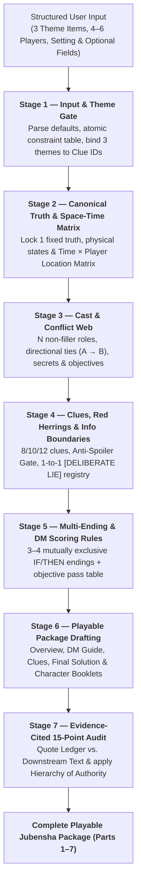

<div align="center">

# 🎭 Jubensha-Generator — Reusable LLM Skill

**A pure-text, model-portable LLM Skill for generating logically consistent, playable 4–6 player Jubensha (剧本杀) tabletop role-playing games.**

[](report.md#q3-game-concept-and-theme-design)
[](jubensha-generator/SKILL.md)
[](report.md#q6-evaluation-and-failure-analysis)
[](jubensha-generator/assets/host-guide-template.md)

</div>

---

## ✨ Overview

`jubensha-generator` turns any general-purpose instruction-following LLM (~70B parameters or fewer) into a structured tabletop mystery designer. Rather than relying on a fragile one-shot prompt, the Skill implements a **Ledger-First, Prose-Second, Audit-Last** architecture that locks canonical facts, space-time locations, directional relationships, information boundaries, and deterministic ending triggers *before* drafting a single paragraph of player-facing prose.

### Key Highlights
- **Zero External Dependencies**: Strictly pure Markdown (`SKILL.md`, `references/`, `assets/`). No scripts, APIs, plugins, or vendor-specific features.
- **No Hard-Coded Story**: 100% reusable across settings, historical periods, tones, difficulties (`easy` / `medium` / `hard`), and player counts (`4–6`).
- **Structural Theme Integration**: Enforces a *Theme Implementation Gate* binding all three theme items to concrete player-visible clues and deduction steps.
- **Deterministic Multi-Ending Play**: Fixed central truth with 3–4 mutually exclusive `IF ... THEN ...` endings and an explicit DM objective scoring table.
- **Evidence-Cited 15-Point Self-Audit**: Cross-checks timelines, co-location witnesses, lie tags, red herrings, and solution proof chains with a defined Repair Protocol.

---

## 🏗️ Seven-Stage Generation Pipeline



---

## 📦 Submission Directory & File Index

| Submission | Path | Description |
| :--- | :--- | :--- |
| **1. Group Report** | [`report.md`](report.md) | Full Q1–Q7 report covering Design Philosophy, Fun Mechanics, Theme Concept (Set 15), 7-Stage Workflow, Consistency Mechanisms, Iterative Evaluation & Failure Analysis, and Usage Guide. |
| **2. Skill Directory** | [`jubensha-generator/`](jubensha-generator/) | Pure-text reusable Skill (`SKILL.md`, `references/`, `assets/`). Zero code or hard-coded stories. |
| **3. Final Input** | [`submission/final_input.md`](submission/final_input.md) | Complete structured input used for our final submission (5 players, Medium, fogbound ferry *MV Meridian*). |
| **3. Generated Game** | [`submission/final_generated_game.md`](submission/final_generated_game.md) | Unmodified, genuinely generated 4,988-word playable game produced by the final frozen Skill. |

<details>
<summary><b>View full Skill directory tree</b></summary>

```text
jubensha-generator/
├── SKILL.md                              # Input contract, 7-stage workflow & output discipline
├── references/
│   ├── game-design-guidelines.md         # Theme rules, engagement mechanics & multi-ending design
│   └── consistency-checklist.md          # Evidence-cited 15-point audit & repair protocol
└── assets/
    ├── canonical-ledger-template.md      # Part 1 immutable planning ledger (output first)
    ├── host-guide-template.md            # Parts 2–5 & Part 7 (Overview, DM Guide, Clues, Solution, Audit)
    └── character-booklet-template.md     # Part 6 player-facing character booklet template
```

</details>

---

## 🚀 Quick Start

1. Load [`jubensha-generator/SKILL.md`](jubensha-generator/SKILL.md) along with all Markdown files in [`references/`](jubensha-generator/references/) and [`assets/`](jubensha-generator/assets/) into any general-purpose LLM's system/Skill context.
2. Set `max_tokens` to at least **12,000–16,384** (disable unrestricted hidden thinking or cap thinking budget ≤2,048 tokens so the full 7-part package is never truncated).
3. Pass a structured input following the Input Contract:

```yaml
theme_items:
  - Duty Rota
  - Unknown Number
  - One Person Too Many
number_of_players: 5
setting: Overnight cross-channel cargo-and-passenger ferry (MV Meridian) halted in dense winter fog mid-channel
historical_period: contemporary 2020s
tone: tense claustrophobic psychological suspense
difficulty: medium
supernatural_elements: none
central_conflict_type: disappearance
special_requirements: No player is a police officer or professional detective. At least two player characters share a hidden past connection.
```

> See **[Q7. Skill Usage Guide](report.md#q7-skill-usage-guide)** in `report.md` for the complete Input Contract, default behaviors, unsupported inputs, and known limitations.

---

## 📊 Iterative Evaluation & Cross-Model Portability

Every version (**v1 → v2 → v3**) was evaluated across diverse player counts (`4–6`), eras (`1987`, `1998`, `2020s`, `2048`), tones, and conflict types using a strict 30-point rubric evaluator (`qwen3.8-max`, temperature `0.1`).

| Run | Skill | Model | Scenario Profile | Theme (/5) | Constr. (/5) | Consist. (/7) | Solv. (/5) | Play. (/5) | Narr. (/3) | Total (/30) |
| :--- | :---: | :--- | :--- | :---: | :---: | :---: | :---: | :---: | :---: | :---: |
| **v1 Baseline** | v1 | `qwen3.8-27b` | 5p / Med / Ferry Disappearance | 4 | 3 | 4 | 2 | 3 | 1 | **17** |
| **v2 Revision** | v2 | `qwen3.8-27b` | 5p / Med / Ferry Disappearance | 5 | 4 | 4 | 4 | 5 | 3 | **25** |
| **Unseen Test** | v3 | `qwen3.8-27b` | 4p / Hard / 1987 Alpine Train | 4 | 4 | 4 | 3 | 4 | 2 | **21** |
| **Portability** | v3 | `deepseek-v4.1-flash` | 6p / Hard / 2048 Antarctic Noir | 5 | 4 | 4 | 3 | 4 | 3 | **23** |
| **Submitted Game** | **v3** | **`qwen3.8-flash`** | **5p / Med / MV Meridian Ferry** | **5** | **4** | **5** | **4** | **4** | **3** | **25** |

Full failure analyses (including all 10 runs without hiding failed generations) are documented in **[Q6. Evaluation and Failure Analysis](report.md#q6-evaluation-and-failure-analysis)**.
